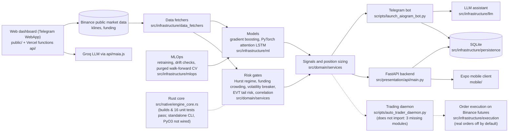

# MaBuy

MaBuy is a personal research and engineering project on cryptocurrency perpetual futures (BTC, ETH and SOL on Binance USD-M). It includes:
- a Python trading and research codebase;
- a Telegram bot;
- a FastAPI backend;
- a web dashboard;
- an Expo mobile client.

**Status: research and development. No client capital is managed, and no profitability is claimed.**

## What this repository is, and what it is not

- **It is a working codebase:** feature engineering, risk gates, model-training code, a Telegram bot and an API, with a pytest suite.
- **It is not evidence of a profitable strategy.** No backtest or live result in this repository has been independently validated.
- **Earlier long-form documents were removed from this public version:** a research paper, a risk manual, investor and pitch materials, and a self-assigned "score". Their headline numbers could not be reproduced.

The "5-year" backtest script (`scripts/run_5y_deep_backtest.py`) is a concrete example. It fetches at most about 1,500 real 4-hour candles and fills the rest of the five years with **synthetic random-walk prices**. Its output therefore says nothing about real market history. The script is kept unmodified as an example of what *not* to rely on.

## Architecture

How the parts depend on each other. The diagram was drawn from the actual imports of the entry points. Dashed lines mark parts that are not working or not integrated.



The web dashboard reads market data directly from Binance's public API and does not use the FastAPI backend.

## Repository layout

| Path | Contents |
|---|---|
| `src/domain/` | Entities and about 50 domain services: risk gates (Hurst regime, funding crowding, volatility circuit breaker, correlation), sizing, signal logic |
| `src/native/` | Standalone Rust microstructure crate (`engine_core.rs`, `Cargo.toml`, `bin/engine_cli.rs`, `parity/check_parity.py`); zero default deps, 16 unit tests; PyO3 optional feature not built offline |
| `src/infrastructure/` | Binance data fetchers, execution on Binance futures, SQLite persistence, ML (gradient boosting, PyTorch LSTM), MLOps, LLM client |
| `src/application/`, `src/presentation/` | Use cases, the FastAPI app (`src/presentation/api/main.py`), the Telegram bot |
| `scripts/` | Entry points: bot launcher, trading daemon, backtests, maintenance tools |
| `tests/` | pytest suite |
| `public/`, `api/` | Static web dashboard and serverless functions (Vercel) |
| `mobile/` | Expo / React Native client |

## Safety

The codebase contains modules that **can place real orders on Binance futures**:
- `src/infrastructure/execution/binance_trader.py`;
- `scripts/auto_trader_daemon.py`;
- `scripts/emergency_close_all_binance.py`.

In this public version real orders are **off by default** and need `REAL_TRADING_ENABLED=true`. Do not enable it. The trading logic has not been validated, and losses on leveraged futures can be larger than you expect.

Never commit real keys. All credentials are read from environment variables; see `.env.example`.

## Web dashboard (trading terminal)

`public/mainvest.html` is a Telegram WebApp / web dashboard (live: https://mabuy.vercel.app). The main screen is a dense trading-terminal view.

**Data it shows.** All market data comes from Binance's public API in the browser:
- prices and 24 h statistics (spot `ticker/24hr`);
- candles (`klines`);
- the order book (`depth`) — the imbalance is computed from real depth within ±1 % of mid;
- funding (USD-M `premiumIndex`).

**When Binance is unreachable.** Nothing is simulated:
- the feed indicator switches to "no connection";
- the chart shows "no data";
- the signal shows "no data".

**The "signal".** It is a plain indicator rule: EMA 7/21 crossover, RSI 14, take-profit / stop-loss levels from ATR. Its "strength" is a score on a scale, not a probability, and the page says so.

**Demo trades.** These are paper trades on a local demo balance. They use the selected coin and amount, and the signal's direction unless the user picks one. PnL uses real prices only.

**Win cards** are labelled either "demo trade" or, when built from a signal, "hypothetical, not a trade result".

## MaIA chat (web dashboard)

The chat in `public/mainvest.html` never talks to an LLM directly. It calls the serverless function `api/maia.js`, which:
- forwards the question and the recent dialogue to Groq;
- reads the key only from the server environment (`GROQ_API_KEY` in the Vercel project settings);
- answers only same-origin requests, unless you list other sites in `ALLOWED_ORIGINS` (comma-separated);
- rejects oversized input;
- returns **503** when no key is configured or the model does not answer.

In that case the page says that MaIA is unavailable. It does **not** fall back to invented "analysis" or trading signals; earlier versions did.

## Running locally

```bash
python -m venv .venv
.venv\Scripts\activate          # Windows; on Linux/macOS: source .venv/bin/activate
pip install -r requirements.txt
cp .env.example .env            # fill in only what you need; leave REAL_TRADING_ENABLED=false
python -m pytest -q
```

Optional Rust core (offline, zero external dependencies):

```bash
cargo test --manifest-path src/native/Cargo.toml --offline
cargo build --manifest-path src/native/Cargo.toml --release --offline
python src/native/parity/check_parity.py --bench
```

Python runtime services do not import the Rust core via PyO3 yet; `check_parity.py` verifies parity against Python via `engine_cli` and documents where definitions differ (single-scale Rust R/S Hurst vs 3-chunk OLS `HurstRegimeService`, incremental USD OFI vs snapshot OBI).

Test status of this snapshot (Windows, Python 3.13, 18 November 2026):
- **345 passed, 13 failed** out of 358 collected tests;
- one more test module cannot be imported (see below).

The 13 failures already existed before this public snapshot was made. They are in the v4 ensemble engine, the API prediction endpoints, a mobile-gateway endpoint and the Telegram formatter tests.

Known gaps:
- The owner/admin Telegram ID is a placeholder (`100000001`) throughout the code. Set your own.
- `scripts/auto_trader_daemon.py` imports three modules that were never committed: `execution_shortfall_benchmarker`, `microstructure_ensemble` and `research_exploration_sleeve`. As a result, neither the daemon nor `tests/unit/telegram/test_dynamic_signal_card.py` can be imported.
- Several components call external services (Binance, Telegram, LLM APIs) and need your own credentials.

## How it was built

Most of this code was written with AI coding assistants, directed and reviewed by the author. Some of the documentation in `docs/` was generated in the same way. Read it as design notes, not as results.

## License

MIT; see [LICENSE](LICENSE). Provided for educational and research purposes only. Nothing here is financial advice.
