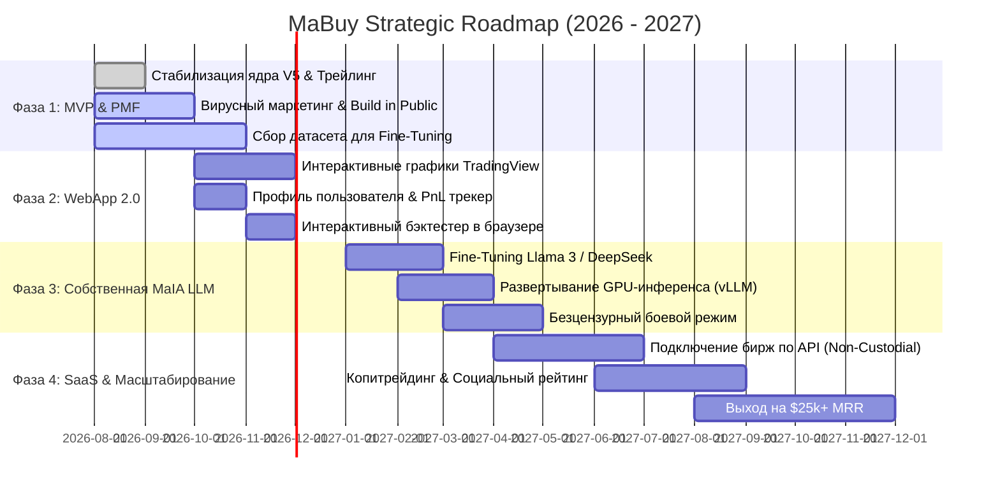

# 🚀 Стратегический Роудмап MaBuy (2026–2027)
### Трансформация из MVP в ведущую экосистему финансового ИИ и автономного трейдинга

---

## 🧭 Видение продукта (Product Vision)
**MaBuy** — это не очередной «сигнальный канал», а высокотехнологичный **персональный финансовый второй пилот (AI Copilot & Auto-Execution Platform)**, сочетающий:
1. **Строгую математику институционального уровня** (Критерий Келли, Прыжковая диффузия Мертона, Волатильность Гармана-Класса, L2 Order Flow Imbalance).
2. **Живой вирусный характер** (Харизматичные персоны MaIA: Квант, Дзен, Цундере, Яндере).
3. **Безупречный UI/UX** (Telegram Mini App уровня Revolut/Apple Card + автономный демон 24/7).

---

## 🗺️ Квартальный план развития (Roadmap Phases)

---

## 📍 Детализация фаз развития

### 🟢 ФАЗА 1: Текущий MVP, Проверка PMF и Сбор Данных (Август — Октябрь 2026)
> **Главная цель:** Стабильный трек-рекорд 24/7, безопасность микро-депозитов, вирусный органический рост до первых 1,000–3,000 пользователей.

- [x] **Квантовое ядро V5:** Внедрение динамического $R:R$ ($1:1.8 \to 1:3.2$), безопасных плеч ($1x-5x$) и 2-уровневого трейлинг-стопа (Break-Even при $+35\%$, Profit Lock при $+70\%$).
- [x] **MLOps Датасет-коллектор:** Автоматическое логирование всех диалогов с Майей, сигналов и рыночных исходов в ChatML JSONL для будущего обучения собственной нейросети.
- [x] **Zero-Downtime Hot Backup:** 6-часовые горячие бэкапы SQLite с шифрованием Fernet в Telegram Vault.
- [ ] **Контент-маркетинг Build in Public:**
  - Публикация 2-3 коротких видео в неделю (TikTok / Reels / YouTube Shorts) в IT/Humor/Math формате.
  - Статья-кейс на DTF / Habr: *«Как мы пишем автономного торгового ИИ-помощника на Python: от первых 30 сделок до +23% ROI»*.
  - Telegram-канал проекта с открытой статистикой и разбором математики.

---

### 🟡 ФАЗА 2: Интерактивный WebApp 2.0 & Профиль Пользователя (Октябрь — Декабрь 2026)
> **Главная цель:** Превратить Telegram Mini App в полноценное финансовое веб-приложение институционального уровня (Revolut meets Bloomberg).

#### 1. Личный кабинет и Профиль трейдера:
- **Индивидуальный Dashboard:** Баланс, уровень депозита ($< \$100$, $\$100-\$1,000$, $\$1,000+$), текущая доходность, процент успешных сделок (Personal Win Rate).
- **Система уровней и ачивок (Gamification):**
  - Бейджи: *«Дисциплинированный квант»* (10 сделок по строгому Келли без нарушения SL), *«Дзен-инвестор»* (30 дней DCA), *«Укротитель Цундере»*.
  - Настройка характера Майи по умолчанию и выбор тем оформления (Cyber Dark, OLED Pure Black, Neon Green, Quantum Navy).

#### 2. Интерактивные графики (Lightweight Charts / TradingView):
- Интеграция профессиональных свечных графиков прямо в Telegram WebApp.
- Визуальное наложение на график зон интереса нейросети: **Целевой коридор (Target Zone)**, **Траектория Монте-Карло**, **Уровни безубытка и трейлинг-стопа**.
- Возможность двигать ползунки плеча и видеть пересчет ликвидации и размера позиции в реальном времени.

#### 3. Веб-инструменты прямо в приложении:
- **Интерактивный DCA-калькулятор:** Симуляция накопления портфеля с 2020 по 2026 год.
- **Матрица стресс-тестов:** Как поведет себя портфель при падении рынка на -30%.
- **Кнопка переключения режимов:** С одного тапа переключаться между «Обучение / Новичок», «PRO Квант» и «Авто-трейдинг».

---

### 🟣 ФАЗА 3: Собственная Нейросеть MaIA LLM (Q1 — Q2 2027)
> **Главная цель:** Полная независимость от внешних API (OpenAI/Groq), нулевая цензура, максимальная персонализация и ультра-быстрый инференс.

#### 1. Обучение модели (Fine-Tuning):
- Базовая модель: **Llama 3.1 8B / DeepSeek-Coder / Qwen 2.5 7B**.
- Обучающая выборка: 50,000+ примеров диалогов, квантовых терминов, разборов графиков, формул риска и авторского юмора Майи (Цундере, Яндере, Дзен, Квант).
- Метод: LoRA / QLoRA с оптимизацией через Unsloth на GPU RTX 4090 / A100.

#### 2. Собственный GPU-сервер:
- Поднятие инференс-сервера на базе **vLLM / TensorRT-LLM** с квантованием FP8/AWQ.
- Время ответа: **$< 300$ миллисекунд**.
- Отсутствие лимитов, цензуры и зависимости от тарифов сторонних провайдеров.

---

### 🔵 ФАЗА 4: Fintech SaaS & Прямая интеграция бирж (Q2 — Q4 2027)
> **Главная цель:** Масштабирование в полноценный SaaS-бизнес с подписочной моделью и $25,000+ MRR.

#### 1. Non-Custodial подключение бирж по API:
- Пользователь подключает свои API-ключи (Binance, Bybit, OKX) **строго без права на вывод средств (Read & Trade Only)**.
- Ключи шифруются в изолированном аппаратном хранилище (KMS / Hardware Security Module).
- Демон MaBuy автоматически открывает и сопровождает сделки прямо на бирже пользователя с соблюдением его индивидуального риск-профиля.

#### 2. Социальный трейдинг & Copy-Trading:
- Публичный лидерборд лучших алгоритмических стратегий.
- Возможность для пользователей следовать за мастер-портфелем MaBuy с разделением прибыли (Profit Sharing).

#### 3. Мобильное приложение & B2B API:
- PWA (Progressive Web App) с push-уведомлениями для iOS и Android.
- B2B API для сторонних крипто-фондов и трейдинг-сообществ, желающих встроить квантовую аналитику MaBuy в свои продукты.

---

## 🏆 Ключевые метрики успеха (KPIs)

| Метрика | Этап MVP (Сейчас) | Фаза 2 (Конец 2026) | Фаза 3 (Середина 2027) | Фаза 4 (Конец 2027) |
|---|:---:|:---:|:---:|:---:|
| **Пользователи бота** | 350 | 5,000 | 25,000 | 100,000+ |
| **Ежемесячный доход (MRR)** | ~$100 | $1,500 – $3,000 | $10,000 | $25,000 – $50,000 |
| **Profit Factor демона** | 1.34 | $\ge 1.80$ | $\ge 2.10$ | $\ge 2.40$ |
| **Max Drawdown** | $< 5\%$ | $< 4\%$ | $< 3.5\%$ | $< 3\%$ |
| **Собственная LLM** | Сбор датасета | Валидация сплитов | Fine-Tuned v1.0 | Fine-Tuned v2.0 |
